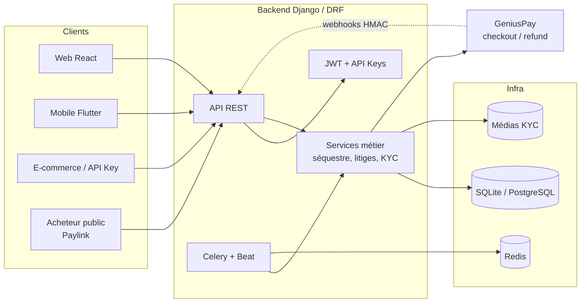
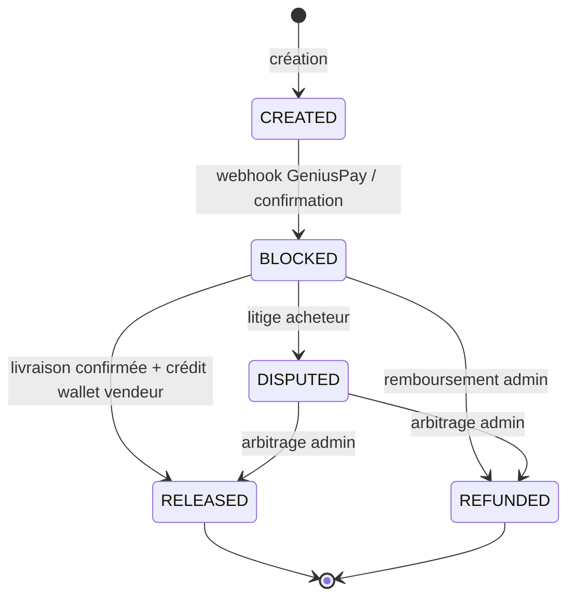
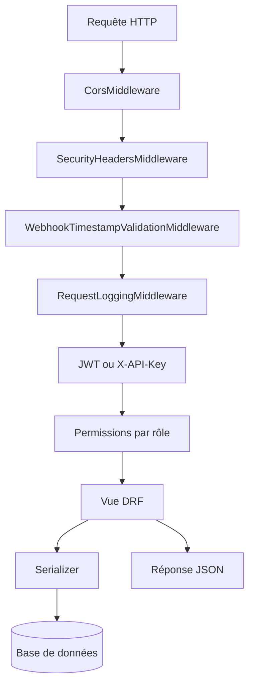
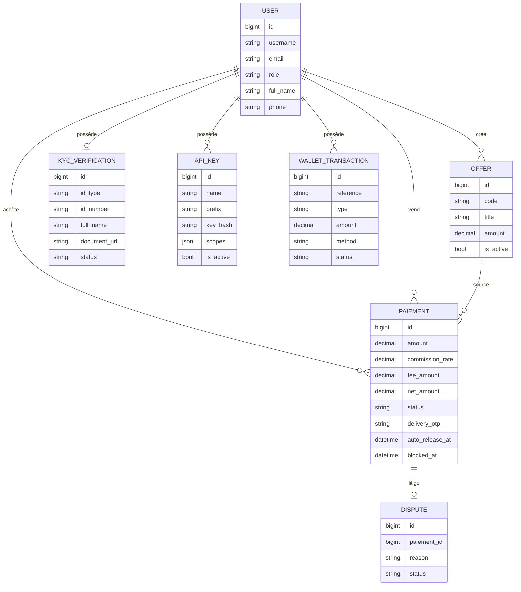
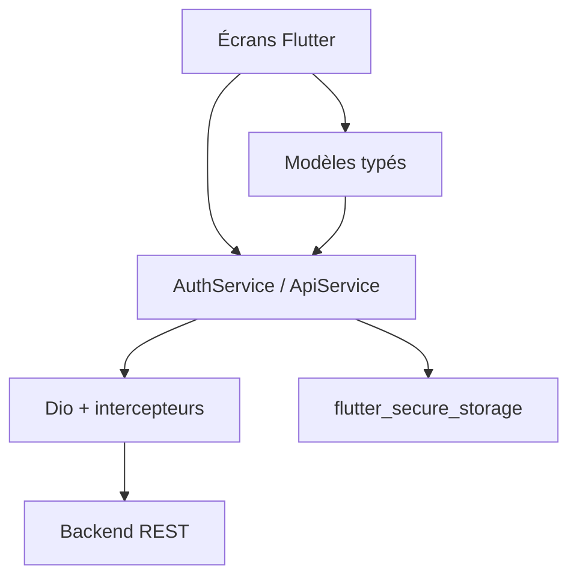
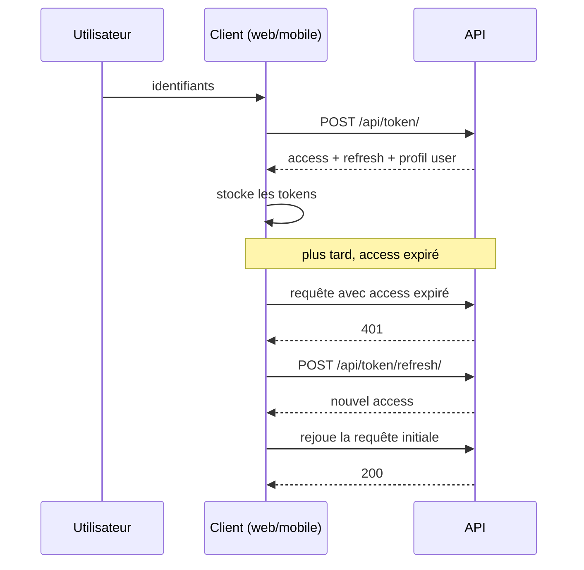
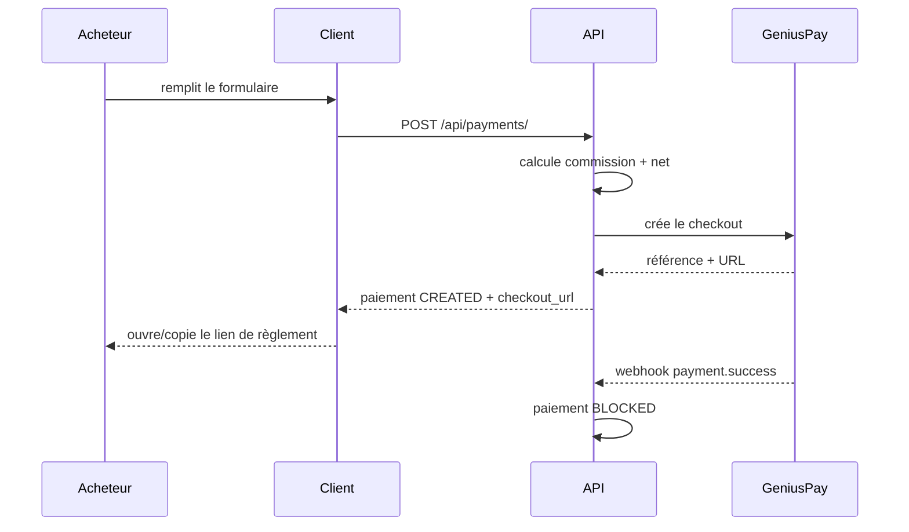
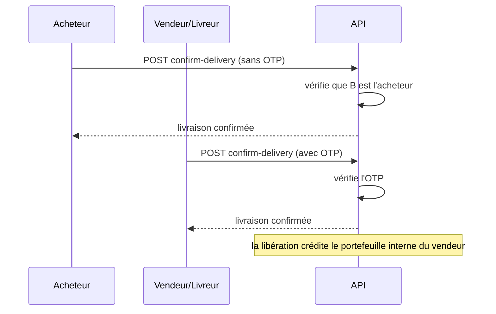
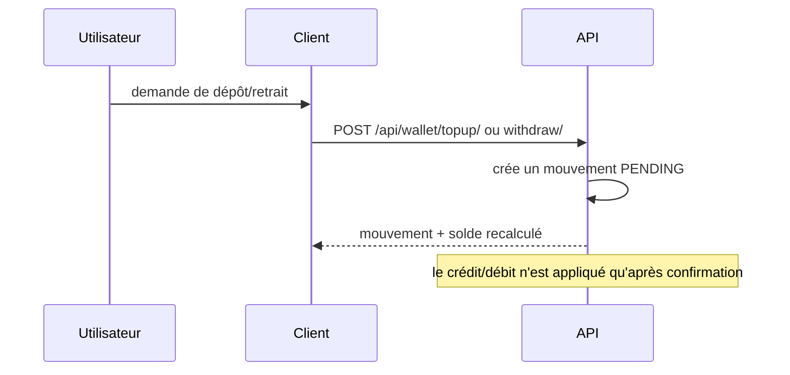

# 0xSeq — Fonctionnalités & Architecture

> Document de référence fonctionnelle et technique.
> Dernière mise à jour : 29 octobre 2026.

## 1. Vue d'ensemble

**0xSeq (0xEscrow)** est une plateforme de paiement sécurisé avec workflow de
livraison, pensée pour l'e-commerce en **FCFA (XOF)**. Elle permet à un acheteur
et à un vendeur de conclure une transaction, de bloquer le paiement, de valider
la livraison par code OTP, puis de libérer ou rembourser les fonds.

Le projet est composé de trois clients autour d'une même API :

| Composant | Technologie | Rôle |
|---|---|---|
| **Backend** | Django 6.1 + Django REST Framework | API métier, authentification, paiements, KYC, portefeuille, webhooks |
| **Web** | React 18 + TypeScript + Vite + Tailwind | Application SaaS complète (dashboard, admin, paylinks publics) |
| **Mobile** | Flutter 3.47 + Dart 3.x | Application Android/iOS : séquestres, portefeuille, KYC, clés API |



### Principe directeur

Le backend est **la seule source de vérité** :

- les soldes du portefeuille sont calculés côté serveur ;
- les commissions et montants nets sont calculés à la création du paiement ;
- les changements d'état suivent une machine à états stricte ;
- aucun client ne modifie localement un solde ou un statut.

---

## 2. Fonctionnalités

### 2.1 Authentification & comptes

- Connexion par **username ou email** (`POST /api/token/`).
- JWT avec access token court (30 min) et refresh token (7 jours, rotation).
- Le profil complet (`user`, `role`, `is_kyc_approved`, `kyc_status`) est renvoyé
  à la connexion : les clients n'ont pas à deviner le rôle depuis le token.
- Rafraîchissement automatique des tokens côté web et mobile.
- **Seul un 401** invalide la session ; les 429 et erreurs 5xx restent
  transitoires.
- Changement de mot de passe : `POST /api/me/password/`.
- Rôles : `client`, `seller`, `member`, `developer`, `deaph` (admin).

### 2.2 Séquestre (escrow)

- Création d'un paiement par un **client** (`POST /api/payments/`) ou par un
  acheteur depuis un Paylink.
- Commission configurable par l'administration (1 % par défaut) :
  `fee_amount = amount × commission_rate`, `net_amount = amount - fee_amount`.
- **Snapshot immuable** du titre, de la description et des conditions de
  livraison au moment de la commande.
- Machine à états :



- Un lien de checkout GeniusPay (`checkout_url`) est fourni à la création.
- Le timer d'auto-release est armé à l'entrée en `BLOCKED`, puis suspendu en cas
  de litige.

### 2.3 Paylinks vendeur

- Un vendeur ou un membre crée une offre (`POST /api/offers/`).
- Le backend génère un code opaque unique `OFF-XXXX-XXXX`.
- Consultation publique sans authentification (`GET /api/offers/{code}/`) avec
  badge KYC du vendeur.
- Commande directe (`POST /api/offers/{code}/checkout/`) : l'acheteur n'a aucun
  numéro de compte à saisir, le vendeur est rattaché automatiquement.
- QR code et URL de paiement générés côté clients.

### 2.4 Validation de livraison

- Un code OTP à 6 chiffres est généré à la création du paiement.
- L'acheteur peut confirmer directement la réception.
- Le vendeur/livreur peut valider avec l'OTP fourni par l'acheteur.
- `POST /api/payments/{id}/confirm-delivery/`.
- La livraison confirmée appelle `release_funds()` : le `net_amount` est crédité
  dans le **portefeuille interne du vendeur** (`BLOCKED` → `RELEASED`).
- Le vendeur peut ensuite demander un retrait Mobile Money (voir 2.7).

### 2.5 Litiges

- L'acheteur ouvre un litige sur un paiement `BLOCKED`
  (`POST /api/payments/{id}/dispute/`).
- Le litige suspend immédiatement l'auto-release.
- L'administrateur arbitre (`POST /api/disputes/{id}/resolve/`) :
  `release` (crédit du portefeuille vendeur) ou `refund` (acheteur).

### 2.6 KYC (Know Your Customer)

- Dépôt d'un dossier : `POST /api/kyc/` avec `id_type`, `id_number`,
  `full_name`, `document_url`.
- Types acceptés : `cni`, `passport`, `driving_license`.
- Statuts : `NONE` → `PENDING` → `APPROVED` / `REJECTED`.
- Validation administrateur : `POST /api/kyc/{id}/review/`.
- Le document doit être un lien `https://` ou `/media/` ; les protocoles
  dangereux (`javascript:`, `data:`, `file:`) sont rejetés.
- Téléchargement protégé du justificatif : `GET /api/kyc/{id}/document/`.

### 2.7 Portefeuille interne

- Solde calculé à partir du grand livre et des séquestres libérés :
  - crédits séquestres (`net_amount` des paiements `RELEASED`) ;
  - rechargements complétés ;
  - retraits complétés ;
  - retraits en attente réservés.
- La libération d'un séquestre **crédite directement ce portefeuille** : aucun
  virement externe automatique n'est simulé.
- `GET /api/wallet/` renvoie le solde, les totaux et les 100 derniers
  mouvements.
- Demandes de dépôt/retrait Mobile Money (`WAVE`, `ORANGE_MONEY`, `MTN_MOMO`),
  **toujours créées en `PENDING`**.
- Minimum : 1 000 FCFA.
- Un administrateur confirme ou rejette un mouvement
  (`POST /api/wallet/transactions/{id}/review/`) : c'est l'étape de cashout
  réel vers Wave / Orange Money / MTN MoMo.

### 2.8 Clés API développeur

- Réservé aux rôles `developer` et admin.
- `GET /api/keys/` : liste des clés (sans secret).
- `POST /api/keys/` : création, secret affiché **une seule fois**.
- `DELETE /api/keys/{id}/revoke/` : révocation immédiate.
- Scopes : `payments:read`, `payments:create`, `payments:refund`.
- Authentification externe via l'en-tête `X-API-Key`.

### 2.9 Webhooks & lecture GeniusPay

- `POST /api/webhooks/geniuspay/`.
- Vérification HMAC SHA-256 (`X-Webhook-Signature`).
- Fenêtre temporelle anti-replay de 5 minutes.
- Journal d'idempotence `WebhookEventLog` pour ignorer les doublons.
- Événements traités : `payment.success` → `BLOCKED`, `payment.refunded` →
  `REFUNDED`.

Opérations de lecture du contrat GeniusPay également branchées :

- `GET /payments` → `GeniusPayService.list_payments()` ;
- `GET /payments/{reference}` → `get_payment()` ;
- `GET /account` → `get_account()` ;
- `GET /account/balance` → `get_account_balance()`.

Ces lectures alimentent deux routes internes :

- `POST /api/payments/{id}/sync/` : réconcilie l'état local avec le fournisseur
  (répare un webhook manqué). `completed` → `BLOCKED`, `refunded` →
  `REFUNDED` ; aucun payout n'est déclenché.
- `GET /api/geniuspay/account/` : solde et informations du compte marchand,
  réservé aux administrateurs.

### 2.10 Administration & paramètres

- Paramètres plateforme (`GET/PATCH /api/platform/settings/`) :
  délai d'auto-release, taux de commission, montant minimum, mode maintenance,
  annonce.
- Interface admin web : utilisateurs, KYC, litiges, mouvements de portefeuille,
  paramètres.

---

## 3. Architecture backend

### 3.1 Organisation

```text
config/                 Configuration Django, settings, URLs, Celery
escrow/
├── models.py           User, Offer, Paiement, Dispute, KYC, APIKey,
│                       WalletTransaction, PlatformSettings, WebhookEventLog
├── serializers.py      Contrats d'entrée/sortie de l'API
├── views.py            Endpoints métier
├── urls.py             Routage REST
├── services.py         Intégration GeniusPay, auto-release
├── authentication.py   Authentification par clé API
├── permissions.py      Rôles et propriété des objets
├── middleware.py       CORS, en-têtes de sécurité, anti-replay, logs
├── tasks.py            Tâches Celery
├── tests.py            Suite d'intégration (103 tests)
└── migrations/
```

### 3.2 Pipeline d'une requête



### 3.3 Modèle de données



### 3.4 Authentification & permissions

Deux mécanismes coexistent :

1. **JWT** (`Authorization: Bearer <token>`) pour le web et le mobile.
2. **Clé API** (`X-API-Key: 0xs_live_...`) pour les intégrations e-commerce.

Les permissions sont vérifiées par rôle (`IsClient`, `IsSeller`, `IsDeveloper`,
`IsAdmin`, `IsOwnerOrAdmin`) et par propriété de l'objet (un acheteur ne voit
que ses paiements, etc.).

### 3.5 Tâches asynchrones

| Tâche | Rôle |
|---|---|
| `task_auto_release_expired_escrows` | Libère les séquestres expirés vers le portefeuille vendeur |
| `task_release_single_escrow` | Libère un séquestre unitaire vers le portefeuille vendeur |
| `task_purge_old_idempotency_logs` | Purge des journaux de webhooks |

---

## 4. Architecture web (React)

### 4.1 Stack

- React 18 + TypeScript
- Vite 5 (build/dev)
- React Router 6
- Tailwind CSS 3
- Recharts (graphiques)
- Lucide React (icônes)

### 4.2 Organisation

```text
frontend/src/
├── app/router.tsx          Routes publiques, protégées et admin
├── components/
│   ├── layout/             DashboardLayout, Sidebar, TopBar
│   └── ui/                 Button, Card, etc.
├── context/
│   ├── AuthContext.tsx     Session, login, logout, refresh profil
│   ├── ThemeContext.tsx    Thème clair/sombre
│   └── ToastContext.tsx    Notifications UI
├── features/               Un dossier par domaine
│   ├── auth/               Login, Register
│   ├── dashboard/
│   ├── escrow/             Liste, création, détail
│   ├── offers/             Paylinks + checkout public
│   ├── transactions/
│   ├── wallet/
│   ├── api_keys/
│   ├── security/           KYC, mot de passe
│   ├── profile/
│   ├── notifications/
│   └── admin/
├── lib/
│   ├── api.ts              Client HTTP + refresh single-flight
│   ├── roles.ts            Règles de rôles
│   └── platform-settings.ts
└── types/escrow.ts         Types partagés
```

### 4.3 Routes

| Route | Accès | Écran |
|---|---|---|
| `/` | Public | Landing |
| `/login`, `/register` | Public | Authentification |
| `/pay/:code` | Public | Checkout d'un Paylink |
| `/dashboard` | Authentifié | Tableau de bord |
| `/transactions` | Authentifié | Transactions |
| `/escrow`, `/escrow/new`, `/escrow/:id` | Authentifié | Séquestres |
| `/offers` | Authentifié | Paylinks vendeur |
| `/wallet` | Authentifié | Portefeuille |
| `/api-keys` | Authentifié | Clés API |
| `/security` | Authentifié | KYC & sécurité |
| `/profile` | Authentifié | Profil |
| `/notifications` | Authentifié | Notifications |
| `/admin` | Rôle `deaph` | Administration |

### 4.4 Client HTTP

`frontend/src/lib/api.ts` centralise :

- l'injection du token Bearer ;
- le rafraîchissement **single-flight** (une seule requête de refresh même en
  cas d'appels concurrents) ;
- la reprise de la requête initiale après refresh ;
- l'invalidation de session uniquement sur 401 ;
- la normalisation des erreurs API en `ApiError` lisible.

---

## 5. Architecture mobile (Flutter)

### 5.1 Stack

- Flutter 3.47 / Dart 3.x
- Provider (injection d'état)
- Dio (HTTP)
- `flutter_secure_storage` (tokens)
- `intl` (formats FCFA/dates)
- `qr_flutter` (QR codes)
- `url_launcher` (ouverture checkout / Paylink)
- `lucide_icons_flutter` (icônes)

### 5.2 Organisation

```text
mobile/lib/
├── main.dart               TrustApp + AuthGate (autorité de navigation)
├── core/
│   ├── constants/          Couleurs, endpoints API
│   ├── models/             EscrowTransaction, Offer, UserProfile,
│   │                       ApiKey, KycRecord, WalletTransaction
│   ├── services/
│   │   ├── api_service.dart    Dio, refresh, méthodes typées
│   │   └── auth_service.dart   Session, login, profil, logout
│   └── theme/              Thème sombre
├── features/
│   ├── auth/               Splash, Login, Register
│   ├── navigation/         MainNavScreen
│   ├── dashboard/
│   ├── escrow/             Liste, création, détail
│   ├── paylinks/
│   ├── transactions/
│   ├── wallet/
│   └── profile/            Profil, KYC, clés API, sécurité
└── shared/widgets/         TrustButton, TrustCard, TrustBadge
```

### 5.3 Couches



- **Écrans** : affichage, formulaires, navigation.
- **Services** : règles de session et appels HTTP.
- **Modèles** : désérialisation défensive des réponses backend.
- **Widgets partagés** : cohérence visuelle.

### 5.4 Session et navigation

- `AuthGate` dans `main.dart` est **la seule autorité de navigation** :
  - non authentifié → `LoginScreen` ;
  - authentifié → `MainNavScreen`.
- Login/register/logout ne poussent plus d'écrans manuellement.
- À l'expiration de session, `AuthGate` revient automatiquement à la racine.
- `AuthService.initAuth()` restaure le profil en cache puis le valide via
  `GET /api/me/`.
- Les tokens sont stockés dans le stockage sécurisé de l'OS.

### 5.5 Gestion des erreurs réseau

- Intercepteur de requête : ajout du Bearer token.
- Sur 401 : refresh single-flight, puis rejeu de la requête.
- Si le refresh échoue : session invalidée et notification à `AuthService`.
- 429 / 5xx : conservés, aucune déconnexion.
- `describeApiError()` transforme les erreurs DRF en messages lisibles.

### 5.6 Configuration API

L'URL du backend est configurable au build :

```bash
# Émulateur Android (défaut)
flutter run

# Appareil physique / réseau local
flutter run --dart-define=API_BASE_URL=http://192.168.1.10:8000

# iOS Simulator
flutter run --dart-define=API_BASE_URL=http://127.0.0.1:8000
```

Le manifest Android autorise le HTTP en clair **pour le développement**
uniquement ; il faudra le retirer avant publication.

### 5.7 Écrans et statut de branchement

| Écran | Backend réel | Notes |
|---|---|---|
| Login / Register | ✅ | Profil renvoyé par `/api/token/` |
| Dashboard | ✅ | Liste paginée `/api/payments/` |
| Liste des séquestres | ✅ | Pagination DRF (20/page) |
| Détail séquestre | ✅ | Confirmation acheteur, OTP vendeur, litige |
| Nouveau séquestre | ✅ | Commission/minimum dynamiques, `checkout_url` |
| Paylinks | ✅ | `/api/offers/`, QR code, `pay_url`, garde de rôle |
| Transactions | ✅ | Liste paginée |
| Portefeuille | ✅ | Solde serveur, historique, demandes `PENDING` |
| KYC | ✅ | `/api/kyc/`, document par lien HTTPS |
| Clés API | ✅ | `/api/keys/`, secret affiché une fois, révocation |
| Mot de passe | ✅ | `/api/me/password/` |
| 2FA | ❌ | Affiché « bientôt disponible » |
| Admin | ❌ | Réservé au web |

---

## 6. Flux principaux

### 6.1 Connexion et rafraîchissement



### 6.2 Création d'un séquestre



### 6.3 Livraison et validation



### 6.4 Dépôt / retrait portefeuille



---

## 7. Sécurité

| Mesure | Implémentation |
|---|---|
| Mots de passe | Hash Django, minimum 8 caractères au changement |
| JWT | Access 30 min, refresh 7 jours, rotation |
| Refresh concurrent | Single-flight côté web et mobile |
| Invalidation session | Uniquement sur 401 |
| Clés API | Secret affiché une fois, hash SHA-256 stocké |
| Webhooks | HMAC SHA-256 + timestamp anti-replay 5 min |
| Idempotence | `WebhookEventLog` |
| Concurrence financière | `select_for_update()` + transactions atomiques |
| Rate limiting | 10/min auth, 5/min sensible, 60/min webhooks, 20/min anonyme |
| En-têtes | `X-Frame-Options`, `nosniff`, CSP, Referrer-Policy |
| KYC | Validation stricte des URLs, téléchargement protégé |
| Mobile | Tokens dans le stockage sécurisé OS |
| Web | Tokens en `localStorage` (à migrer vers cookies HttpOnly en production) |

---

## 8. Limites connues

### 8.1 GeniusPay, libération et cashout

GeniusPay **est réellement intégré**, en sandbox comme en live
(`GENIUS_PAY_SANDBOX`, `GENIUS_PAY_URL`, clés API) :

- création de checkout : `POST /payments` ;
- remboursement : `POST /payments/{reference}/refund` ;
- lecture des transactions : `GET /payments`, `GET /payments/{reference}` ;
- compte marchand : `GET /account`, `GET /account/balance` ;
- webhooks `payment.success` → `BLOCKED`, `payment.refunded` → `REFUNDED`.

La réconciliation (`POST /api/payments/{id}/sync/`) utilise
`GET /payments/{reference}` pour réparer un webhook manqué : elle peut passer un
paiement à `BLOCKED` ou `REFUNDED`, mais **ne libère jamais les fonds**.

### Libération vers le portefeuille interne

GeniusPay ne documente **aucun endpoint de payout** (virement sortant vers un
vendeur). Plutôt que de simuler un virement, la libération crédite le
**portefeuille interne** :

- `release_funds(paiement)` verrouille le paiement et effectue
  `BLOCKED`/`DISPUTED` → `RELEASED` ;
- le `net_amount` du vendeur devient immédiatement disponible dans
  `GET /api/wallet/` (`escrow_credits`) ;
- le vendeur demande ensuite un retrait `WAVE`, `ORANGE_MONEY` ou `MTN_MOMO`
  (`POST /api/wallet/withdraw/`) ;
- le mouvement reste `PENDING` jusqu'à confirmation administrateur : c'est
  l'administrateur qui effectue réellement le cashout externe.

`auto_release_expired_escrows()` libère les séquestres `BLOCKED` expirés vers ce
même portefeuille ; les litiges `DISPUTED` sont exclus.

Conséquences assumées :

- `BLOCKED` est un état **interne** ; il ne prouve pas que GeniusPay détient les
  fonds en séquestre.
- Aucun virement externe automatique n'est simulé : le cashout externe reste
  une opération administrateur.
- Aucun solde n'est inventé : le portefeuille est calculé à partir des paiements
  réellement `RELEASED` et des mouvements de portefeuille.

**Ne pas utiliser en production comme séquestre financier avant d'avoir un
accord de conservation des fonds avec le fournisseur de paiement.**

### 8.2 Autres limites

- **KYC** : le backend accepte une URL de document, pas un upload binaire. Le
  mobile propose donc un champ de lien HTTPS.
- **2FA** : non implémentée, affichée comme « bientôt disponible ».
- **Notifications** : pas de push serveur ; l'écran web agrège les événements
  disponibles.
- **Web** : pas de suite de tests automatisés dans le dépôt.
- **Build Linux desktop** : nécessite `libsecret-1-dev` pour
  `flutter_secure_storage`.
- **Android** : AGP 8.11.1 et Kotlin 2.2.20 fonctionnent, mais Flutter annonce
  leur future obsolescence.

---

## 9. Tests et vérifications

### Backend

```bash
source venv/bin/activate
python manage.py test escrow
```

Résultat de référence : **103 tests OK** (authentification, séquestres, litiges,
auto-release, webhooks, réconciliation GeniusPay, Paylinks, KYC, clés API,
portefeuille, paramètres, changement de mot de passe).

### Mobile

```bash
cd mobile
flutter analyze --no-pub
flutter test --no-pub
flutter build apk --debug
```

Résultats de référence :

- `flutter analyze` : **0 problème** ;
- `flutter test` : **9 tests OK** ;
- APK : `mobile/build/app/outputs/flutter-apk/app-debug.apk`.

### Web

```bash
cd frontend
npm run build
```

---

## 10. Points d'extension

1. **Cashout externalisé** : automatiser les retraits Wave / Orange Money /
   MTN MoMo lorsqu'une API de décaissement officielle est disponible (le
   crédit portefeuille, lui, est déjà opérationnel).
2. **Upload KYC** : ajouter un endpoint multipart avec validation de type/taille
   et stockage privé.
3. **2FA** : TOTP ou SMS, avec codes de secours.
4. **Notifications temps réel** : WebSocket/SSE + push mobile.
5. **Tests web** : ajouter Vitest/Playwright sur les parcours critiques.
6. **CI/CD** : pipeline de tests backend + mobile + build APK.
